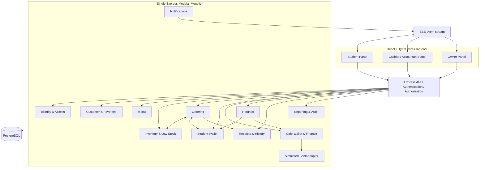

# FASTBite Architecture

**Project:** FASTBite  
**Document:** Architectural Context  
**Version:** 2.0  
**Date:** 15 November 2026  
**Status:** Updated working architecture aligned to the TA-correction PRD and decision log; team/TA review remains required  
**Primary requirements source:** `FASTBite_Final_PRD_TA_Corrections.md` (also mirrored as `FASTBite_Final_Changed_PRD.md` for compatibility)

> This document records the architecture for a university project prototype that demonstrates the intended FASTBite experience. It is not a commitment to deliver a production banking or commercial payment platform. The validated PRD remains the authority for product behavior; this document records how the system is structured.

## 1. System overview

FASTBite is a university-cafe ordering and operations application with three user-facing panels:

1. Student Panel
2. Cashier / Accountant Panel
3. Owner Panel

The selected style is a **modular monolith**. The application has one frontend application, one backend deployment, and one relational database. The frontend presents the three panels according to the authenticated user's role. The backend contains business modules with explicit responsibilities and interfaces. All persistent data is stored in one PostgreSQL database, with logical ownership assigned to modules.

The initial academic implementation uses free and open-source technologies:

- Frontend: React, TypeScript, Vite, Tailwind CSS
- Backend: Node.js, Express, TypeScript
- Persistence: PostgreSQL
- ORM and migrations: Prisma
- Client/server communication: REST over HTTP; Server-Sent Events (SSE) for server-to-client live order/status updates where implemented
- Development and testing: local development tools and free-tier services only where genuinely needed

No paid hosting, live banking API, commercial payment gateway, Kubernetes, microservices, or multiple databases are prerequisites for the academic prototype.

## 2. Architectural goals and drivers

The architecture must:

- Preserve the three-panel access separation in the PRD.
- Prevent duplicate orders and repeated wallet, refund, or stock effects.
- Keep order, inventory, wallet, refund, receipt, and collection records consistent.
- Support the PRD's target test load: 5,000 orders in 24 hours and a peak of 100 orders per minute.
- Support the PRD's screen-update targets: 95% of covered events visible within 3 seconds and latest status visible within 10 seconds after connectivity returns.
- Enforce authorization in backend operations, not only by hiding frontend controls.
- Keep finance and owner-only bank-connection functionality inaccessible to cashier/accountant users.
- Be straightforward for a student team and AI coding agent to build, run, test, and explain without a budget.
- Avoid unnecessary distributed-system infrastructure.

These are architectural goals derived from the PRD and the team's stated academic-project constraints. They do not replace the PRD's exact acceptance criteria.

## 3. Architecture Significant Requirements (ASRs)

| ID | Source in validated PRD | Architectural significance | Architectural concern |
|---|---|---|---|
| ASR-01 | NFR-01: 5,000 orders/24 hours, 100 orders/minute peak, 95% of covered events visible within 3 seconds, recovery visibility within 10 seconds | Influences request handling and status propagation | Efficient backend operations, event delivery, reconnect and refresh behavior, load testing |
| ASR-02 | NFR-02: zero lost/duplicated orders; unique order numbers; no duplicate wallet debit, refund, or stock restoration | Correctness must survive retries and concurrent requests | Database transactions, unique constraints, idempotency, concurrency control |
| ASR-03 | NFR-02 and FR-03–FR-07, FR-09–FR-10, FR-14 | Multiple related records must remain consistent across business operations | Transaction boundaries and coordination through module interfaces |
| ASR-04 | NFR-03 and Section 5 panel permissions | Access boundaries affect every protected operation and record | Authentication, role/permission checks at backend boundaries, data ownership |
| ASR-05 | FR-10, FR-11, NFR-03 and Business Rules 3–6 | Owner-only financial and bank-connection capabilities cross a sensitive trust boundary | Isolated finance interfaces, owner authorization, simulated external integration boundary |
| ASR-06 | FR-08 and FR-17 | Order placement and stock updates may compete for inventory | Inventory ownership, atomic stock changes, threshold evaluation |
| ASR-07 | FR-06 and FR-10 | Refunds can be pending when cafe-wallet funds are insufficient | Explicit refund state, retry-safe processing, wallet/order consistency |
| ASR-08 | FR-07, FR-09, FR-10, FR-14 and Business Rule 18 | Different record types have different retention requirements | Separate data ownership and retention policies |
| ASR-09 | FR-15 and FR-16 | Favorites are private; reorder must use current prices and availability | Customer-scoped data and validation against current menu/inventory records |

Do not promote every functional requirement into an ASR. The table contains requirements whose architectural consequences materially affect structure, security, data, or runtime behavior.

## 4. Selected architectural style

**Decision:** Modular Monolith. See [ADR-001](ADRs/ADR-001-architecture-style.md).

One backend application is deployed as one unit, but its code is separated into business modules. Modules expose documented application interfaces and do not reach into another module's private implementation or directly manipulate another module's tables.

This is preferred over an unstructured monolith because FASTBite has meaningful business boundaries, and over microservices because the project has no independent deployment requirement, no budget for distributed operations, and no demonstrated need for separately scaled services.

## 5. Major components and boundaries

### 5.1 Frontend application

One React application contains three panel experiences:

- **Student Panel:** customer-facing menu, cart, ordering, student wallet, personal records, Favorites, and reorder.
- **Cashier / Accountant Panel:** permitted operational order, menu, stock, preparation, receipt, and collection functions.
- **Owner Panel:** owner operational capabilities plus cafe-wallet finance, reports, and the owner-only bank-connection demonstration.

Frontend route guards and hidden navigation improve usability, but are not security controls. The backend must independently authorize every protected operation.

### 5.2 Backend modules

| Module | Owns responsibility for | Must not do |
|---|---|---|
| Identity & Access | Sign-in, sessions/tokens, password/PIN verification support, roles and permissions | Decide business order or wallet outcomes |
| Customer | Student profile and customer-scoped preferences such as Favorites | Read or expose another customer's private records |
| Staff Access | Staff identities/permission assignments, to the extent supported by the approved PRD decisions | Grant finance access to cashier/accountant roles |
| Menu | Menu item details, prices, categories, and manual availability | Directly change order or wallet records |
| Inventory | Countable stock, stock movements, thresholds, low-stock evaluation | Own order lifecycle or payment decisions |
| Ordering | Cart submission, order identity, order lifecycle coordination, order-item snapshots | Bypass inventory or wallet interfaces |
| Student Wallet | Simulated student wallet balance and ledger operations | Connect to a real payment provider |
| Cafe Wallet & Finance | Simulated cafe-wallet ledger, owner-only finance operations, finance summaries | Expose finance functions to cashier/accountant |
| Refunds | Refund request/state and coordination with the applicable wallet operation | Create untraceable balance changes |
| Receipts & History | Receipt records, historical order snapshots, collection verification records | Recalculate historical orders from current menu prices |
| Notifications | In-app notification records and delivery of updates to connected clients | Become the authoritative source of order status |
| Reporting & Audit | Operational/financial read models and audit events, with role-filtered access | Change source business records |
| Bank Integration Adapter | Simulated bank connection lifecycle for the academic demonstration | Store real bank credentials or claim real transfers occurred |

Staff Access supports the recorded OQ-05/OQ-06/OQ-19 scope: Owner creates/deactivates cashier/accountant accounts and assigns operational permissions. Cancellation/refund and cafe open/close are denied by default unless explicitly delegated. Cafe finance and bank permissions are owner-only and non-delegable.

### 5.3 Module dependency rules

1. A module owns its business rules and data access.
2. Other modules use its exported application/service interface, not its private functions or Prisma models.
3. The frontend communicates with backend API routes; it never accesses the database.
4. API controllers validate input and delegate business operations to application services.
5. Business logic must not be embedded only in React components or route handlers.
6. Cross-module operations are coordinated by an application-level use case/service. Where a single business operation must update multiple records, use a database transaction and the participating modules' defined operations.
7. Reporting reads data through explicit query interfaces or approved reporting queries; it must not become a general write path.
8. Shared code is limited to genuinely shared primitives (for example, IDs, date/time utilities, validation types). Do not create a generic shared module that absorbs business ownership.

## 6. Interfaces and interactions

### 6.1 Frontend to backend

- Use REST endpoints for commands and queries.
- Authenticate requests and enforce authorization on every protected endpoint.
- Use SSE for server-to-client order/status notifications if implemented. SSE is one-way; user actions still use REST.
- On SSE disconnect/reconnect, the client must refresh authoritative order status through REST rather than assume it received every event.
- Notifications are informative; the persisted order/wallet records remain authoritative.

### 6.2 Backend module interactions

- Ordering calls Inventory through its interface to validate and reserve/deduct countable stock according to the PRD rules.
- Ordering calls Student Wallet through its interface at the appropriate payment/Final Accept stage.
- Unavailable-item and cancellation flows coordinate with Refunds and the relevant wallet module.
- Receipt/History obtains a stable order snapshot from Ordering and records collection verification.
- Reporting obtains permitted data from source modules through read interfaces.
- Bank Integration Adapter is called only by owner-authorized Cafe Wallet & Finance use cases.

### 6.3 External systems

The academic prototype must not depend on a paid or live external provider. Per PRD Section 15 (OQ-01–OQ-04), the bank-connection requirement is an internal FASTBite demo simulator with a predefined demo account, demo credentials, displayed demo OTP, simulated Connected/Failed/Pending outcomes, simulated deposits/withdrawals, transaction records, and simulated failure cases. No real bank credentials, provider APIs, external OTP service, real account access, or actual transfers are implemented or claimed. Every screen and transaction must be clearly labelled simulated.

The Bank Integration Adapter is an internal module boundary, not a separately deployed service. Only owner-authorized Cafe Wallet & Finance use cases may call it. A disconnected or Pending/Failed account cannot transact. Duplicate simulated transfer requests must be idempotent.

Notifications are initially in-app. No paid SMS, email, or push-notification provider is assumed.

## 7. Data responsibilities and persistence

**Decision:** One PostgreSQL relational database. See [ADR-002](ADRs/ADR-002-data-persistence.md).

- PostgreSQL is the single persistent store for the initial prototype.
- Prisma is the database access and migration tool.
- Tables are logically owned by modules. Naming/schema organization should make ownership apparent.
- A module must not import another module's private Prisma repository/model layer.
- Financial changes are represented as ledger/transaction records; do not silently overwrite balances without corresponding transaction history.
- Order items retain the item description and price snapshot required for historical receipts, rather than depending on the current menu record.
- Unique constraints and transaction boundaries must support order-number uniqueness and retry safety.
- Retention behavior follows PRD Section 15: customer order history/receipts are retained for three calendar months from completion/cancellation and then deleted or anonymized by a daily job; student-wallet ledger records and cafe-wallet transaction history are retained without a time limit under the stated rules; audit/financial records are retained for the lifetime of the academic dataset. Account deletion must preserve financial ledger integrity and remove customer-facing access.
- Store timestamps in UTC and use PKT (UTC+05:00) for daily report boundaries.
- Record OQ-18 audit fields for finance, refunds, simulated bank operations, and permission changes: actor ID/role, action, target, UTC timestamp, outcome, and relevant before/after values. Never log passwords, OTP values, or secrets.
- Do not introduce a second database or a cache as a source of truth for the academic version.

## 8. Security and authorization

- The backend is the enforcement point for authentication and authorization.
- Use role-based access plus permission checks for staff actions where the PRD requires permission-based behavior.
- Student access must be scoped to the authenticated student's own records.
- Cashier/accountant must be denied cafe-wallet finance, finance exports, bank-connection operations, and bank-account details.
- Owner-only finance and bank-connection operations must check owner authorization on the backend.
- Store PINs/passwords only using an appropriate one-way password hashing mechanism; never log secrets.
- Do not store real banking credentials or payment secrets in the prototype.
- Cancellation/refund and cafe open/close are denied to cashier/accountant by default unless explicitly delegated; cafe-wallet finance, finance reports/exports, bank details, and bank operations are owner-only and non-delegable.
- Staff permissions are assigned by the owner; every protected action is checked on the backend.
- Do not rely on route hiding, client-side roles, or a disabled button as the only access control.
- Keep secrets out of source control; use local environment variables for development configuration.

The permission matrix and implementation-critical behaviors are specified in PRD Sections 5.4–5.6 and 15. Decisions OQ-01–OQ-19 are recorded in `FASTBite_TA_Correction_Decision_Log.md`; the log identifies these as assistant-proposed resolutions that still require team/TA review.

## 9. Reliability, consistency, and performance

- Use database transactions for operations that must change related order, stock, wallet, refund, and receipt records consistently.
- Use idempotency protection for order submission and retryable financial/stock actions.
- Generate order identifiers under a concurrency-safe strategy and enforce uniqueness in the database.
- Validate stock at the point of order acceptance; do not rely only on a stale menu display.
- Treat persisted state as authoritative. Client events and notifications may be delayed or repeated.
- Use SSE only as a delivery mechanism; provide a REST refresh path for recovery.
- Test the PRD's 5,000 orders/24 hours and 100 orders/minute peak targets with a documented test environment. Do not claim the targets are met until measured.
- Do not add queues, Redis, distributed locks, or microservices unless measured evidence and a human-approved ADR justify them.

## 10. Architecture diagram

The diagram is conceptual. The backend modules are code modules within one deployment, not separate services. The diagram does not authorize direct cross-module database access.

## 11. Architectural constraints

- Preserve the modular monolith; do not create microservices or an API gateway.
- Use the approved stack recorded in [ADR-004](ADRs/ADR-004-technology-stack.md).
- Keep one PostgreSQL database for the initial academic prototype.
- Keep three panels in one frontend application and one backend deployment.
- Enforce access boundaries on the backend.
- Keep cafe-wallet finance and bank connection owner-only.
- Simulate the bank connection; no live bank/payment integration without a new human-approved decision and legitimate sandbox/provider access.
- Do not add paid services or infrastructure as requirements.
- Do not claim production readiness or performance compliance without test evidence.
- Do not invent behavior beyond the PRD and the recorded OQ resolutions. For the stale passages listed in Section 13.1, use the latest Section 15 resolution and decision log as the working baseline; flag the source inconsistency for cleanup.

## 12. Relevant ADRs

- [ADR-001 — Adopt a Modular Monolith](ADRs/ADR-001-architecture-style.md)
- [ADR-002 — Use One PostgreSQL Relational Database](ADRs/ADR-002-data-persistence.md)
- [ADR-003 — Use Three Panels with One Modular Backend](ADRs/ADR-003-application-structure.md)
- [ADR-004 — Adopt a Free TypeScript-Based Technology Stack](ADRs/ADR-004-technology-stack.md)

## 13. Resolved implementation decisions and source caveats

The architecture incorporates the recorded resolutions in PRD Section 15 and `FASTBite_TA_Correction_Decision_Log.md`:

- OQ-01–OQ-04: internal demo bank simulator only; predefined demo account, demo credentials and displayed demo OTP; simulated connection, deposits, withdrawals, transaction history, and failures.
- OQ-05–OQ-06 and OQ-19: Owner manages staff accounts and assigns operational permissions; cancellation/refund and cafe open/close default to denied unless delegated; finance/bank functions are owner-only and non-delegable.
- OQ-07: order status lifecycle and terminal states are explicit; refund status is separate from order status.
- OQ-08–OQ-10: independent five-minute server-timed windows per unavailable item; timeout removes the item and continues with remaining items or cancels if none remain; whole-order cancellation closes other windows and causes one order-level refund; offline deadlines continue and late responses cannot reverse timeout.
- OQ-11: collection is blocked until receipt generation succeeds and the receipt can be verified.
- OQ-12: five consecutive failed wallet authentications in a rolling 24-hour window trigger a 24-hour lock; successful authentication resets the consecutive-failure count.
- OQ-13: timer choices are 1, 2, 3, 5, or 10 minutes; longest accepted To-Cook duration governs; ready-made-only orders skip the cooking timer.
- OQ-14: deleted menu items cannot be newly ordered; historical snapshots and already accepted fulfilment remain valid; pending orders use unavailable-item handling.
- OQ-15–OQ-18: three-calendar-month customer order/receipt retention; preserve wallet ledger integrity after account deletion; PKT reporting day boundary with UTC storage; specified audit fields and academic-dataset retention.

### 13.1 Source consistency caveats requiring editorial cleanup

The uploaded PRD contains stale passages that conflict with its own Section 15 and the accompanying decision log. The architecture follows Section 15 plus the decision log for OQ resolutions, but the PRD should be editorially reconciled before final submission:

1. FR count: Section 7 enumerates FR-01 through FR-17 and Section 16 says 17, but the Section 7 introductory sentence says “14”.
2. Unavailable-item flow: Section 10.6 and parts of Sections 11.2/13.5 still describe timeout behavior as open, while OQ-08–OQ-10 resolve it.
3. Bank connection: Sections 10.11 and 11.5 still refer to an unspecified provider/connection process, while OQ-01–OQ-04 specify an internal demo simulator.
4. OQ-12 terminology: FR-10 describes “five incorrect attempts within one day”; OQ-12 clarifies five consecutive failures in a rolling 24-hour window.
5. The PRD header/source status should explicitly identify the OQ resolutions as proposed decisions for team/TA review, consistent with the decision log.

These are documentation consistency issues, not grounds to invent further requirements. If the PRD is edited, preserve the decision log's status that the resolutions are proposed and require team/TA confirmation.

### 13.2 Remaining implementation details

The architecture is sufficient to propose a codebase structure and begin a local academic prototype. The team still needs to confirm the proposed OQ decisions and settle ordinary design details during implementation, such as exact API route names, entity field names, visual layouts, and test fixtures. These details must remain traceable to the PRD and must not change business rules.

